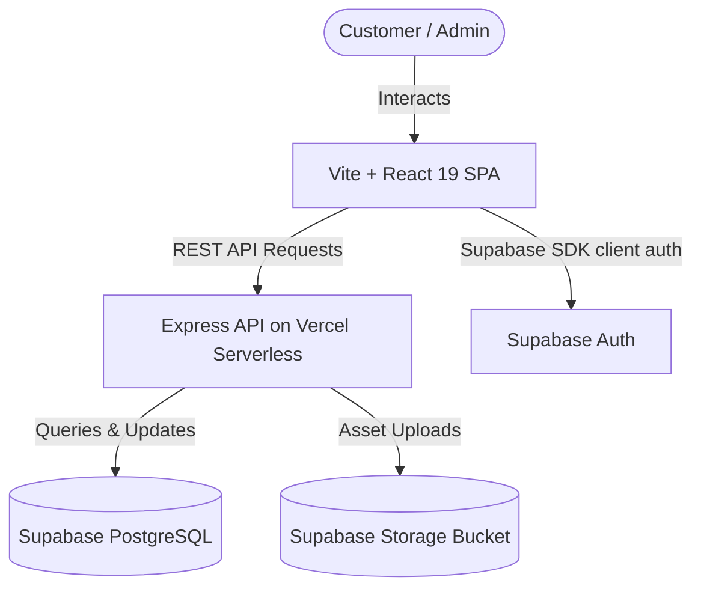

# Ulvic Print

Custom apparel printing e-commerce platform and back-office management system tailored for the Algerian market.

[](https://vite.dev/)
[](https://react.dev/)
[](https://www.typescriptlang.org/)
[](https://tailwindcss.com/)
[](https://supabase.com/)
[](https://expressjs.com/)

---

## Overview

Ulvic Print is a full-stack web application designed for a custom merchandise and t-shirt printing business in Algeria. Customers can browse clothing, pick sizes and colors, and place orders across all 58 Algerian Wilayas with home delivery or desk pickup. Administrators manage the product catalog, update order statuses, adjust regional shipping fees, and export logistics spreadsheets.

---

## Features

### Customer storefront

- Dark mode interface with responsive layout and product imagery
- Bilingual interface with English and French translation via `react-i18next`
- Checkout form configured for the 58 Wilayas of Algeria, supporting home delivery and desk pickup (Livraison à domicile / Bureau) with automated delivery fee calculations
- Selectors for product categories, sizes (S, M, L, XL), colors, and image zoom

### Admin dashboard

- Protected dashboard with JWT and session-based administration
- Order lifecycle tracking through status stages: New, Confirmed, Shipped, Delivered, and Cancelled
- Product catalog management: create, edit, delete products, and toggle stock availability
- Regional delivery rate editor to customize shipping fees for each Wilaya
- Spreadsheet export: download order records into `.xlsx` formats for delivery agencies and accounting
- Direct image uploads to Supabase Storage

---

## Architecture

The application is structured as a single-page application (SPA) with a serverless backend API connected to a PostgreSQL database on Supabase.



---

## Tech stack

- Frontend:
  - [React 19](https://react.dev/) and [Vite](https://vite.dev/)
  - [TypeScript](https://www.typescriptlang.org/)
  - [Tailwind CSS v4](https://tailwindcss.com/)
  - [Lucide React](https://lucide.dev/) (Icons)
  - [React Router DOM v7](https://reactrouter.com/)
  - [i18next](https://www.i18next.com/)
- Backend API:
  - [Express](https://expressjs.com/) (Node.js framework)
  - [Dotenv](https://github.com/motdotla/dotenv)
  - [Multer](https://github.com/expressjs/multer)
- Database & storage:
  - [Supabase PostgreSQL](https://supabase.com/)
  - [Supabase Storage](https://supabase.com/docs/guides/storage)
  - [SheetJS (xlsx)](https://sheetjs.com/)
- Deployment:
  - [Vercel Serverless Functions](https://vercel.com/docs/functions)

---

## Database schema

The PostgreSQL schema consists of three core tables deployed on Supabase:

### `products`

Stores merchandise records:

```sql
CREATE TABLE products (
  id UUID PRIMARY KEY DEFAULT gen_random_uuid(),
  name_en TEXT NOT NULL,
  name_fr TEXT NOT NULL,
  description_en TEXT,
  description_fr TEXT,
  price INTEGER NOT NULL,          -- Price in DZD
  category TEXT,
  images TEXT[] DEFAULT '{}',     -- Array of Storage URLs
  sizes TEXT[] DEFAULT '{}',      -- e.g., ['S', 'M', 'L']
  colors JSONB DEFAULT '[]',      -- e.g., [{"label":"Black","hex":"#000000"}]
  in_stock BOOLEAN DEFAULT true,
  created_at TIMESTAMPTZ DEFAULT now()
);
```

### `orders`

Stores customer purchase orders:

```sql
CREATE TABLE orders (
  id UUID PRIMARY KEY DEFAULT gen_random_uuid(),
  created_at TIMESTAMPTZ DEFAULT now(),
  product_id UUID REFERENCES products(id) ON DELETE SET NULL,
  product_name TEXT NOT NULL,
  size TEXT NOT NULL,
  color TEXT NOT NULL,
  customer_name TEXT NOT NULL,
  phone TEXT NOT NULL,
  wilaya TEXT NOT NULL,
  baladiya TEXT NOT NULL,
  delivery_type TEXT NOT NULL,    -- 'home' | 'desk'
  delivery_fee INTEGER NOT NULL DEFAULT 0,
  total_price INTEGER NOT NULL,
  status TEXT NOT NULL DEFAULT 'new'
);
```

### `delivery_prices`

Maps delivery fees per Wilaya:

```sql
CREATE TABLE delivery_prices (
  wilaya TEXT PRIMARY KEY,
  fee INTEGER NOT NULL DEFAULT 0   -- Fee in DZD
);
```

---

## Getting started

### Prerequisites

- [Node.js](https://nodejs.org/) (v18+)
- [pnpm](https://pnpm.io/) or `npm`
- A [Supabase](https://supabase.com/) project

### 1. Clone and install dependencies

```bash
git clone https://github.com/anesdevv/ulvik-print.git
cd ulvik-print
pnpm install
```

### 2. Configure environment variables

Create a `.env` file in the project root:

```bash
cp .env.example .env
```

Fill in your configuration:

```ini
# Frontend variables (client)
VITE_SUPABASE_URL=https://your-project-id.supabase.co
VITE_SUPABASE_ANON_KEY=your-supabase-anon-key
VITE_API_URL=/api

# Backend variables (server runtime)
SUPABASE_URL=https://your-project-id.supabase.co
SUPABASE_SERVICE_ROLE_KEY=your-supabase-service-role-key
NODE_ENV=development
PORT=5000
```

### 3. Database migrations

Run the initial migration in your Supabase SQL editor:
- `supabase/migrations/20260605000000_init.sql`

This migration creates the required tables and seeds the database with the 58 Algerian Wilayas and baseline shipping fees.

### 4. Running locally

Start the development server:

```bash
pnpm run dev
```

During local development, API requests route through the Vite proxy or through the standalone Express server (`node api/index.ts`).

---

## Deployment

### Deploying to Vercel

This repository includes a `vercel.json` configuration that routes Express endpoints to Vercel Serverless Functions.

1. Install the Vercel CLI:
   ```bash
   npm install -g vercel
   ```
2. Link the repository and deploy:
   ```bash
   vercel
   ```
3. Set your production environment variables in the Vercel project dashboard (`SUPABASE_URL`, `SUPABASE_SERVICE_ROLE_KEY`, `VITE_SUPABASE_URL`, `VITE_SUPABASE_ANON_KEY`, `NODE_ENV=production`).

---

## License

Distributed under the MIT License. See [LICENSE](LICENSE) for details.
